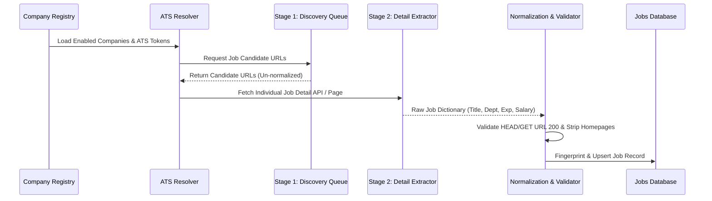

# JobPulse v2 — Connector Architecture & Flow Guide

## Architectural Overview

The JobPulse connector architecture implements a **True Two-Stage Crawling Paradigm** to guarantee data integrity and direct apply link validity.

---

## Supported ATS Connectors

1. **Greenhouse**: `boards-api.greenhouse.io/v1/boards/{token}/jobs?content=true`
2. **Lever**: `api.lever.co/v0/postings/{token}?mode=json`
3. **Workday**: CX REST Endpoint `wday/cxs/{tenant}/{site}/jobs`
4. **Ashby**: `api.ashbyhq.com/posting-api/job-board/{token}`
5. **SmartRecruiters**: `api.smartrecruiters.com/v1/companies/{token}/postings`
6. **Teamtailor**: `{token}.teamtailor.com/jobs.json`
7. **SuccessFactors**: SAP SuccessFactors Career Portal Crawler
8. **Oracle Taleo**: Taleo Jobdetail HTML Crawler
9. **Recruitee**: `{token}.recruitee.com/api/offers`
10. **Jobvite**: Jobvite Career Board Parser
11. **Generic HTML**: Fallback HTML Anchor Link Parser

---

## Canonical URL Principles

- Every stored job contains `job_url` pointing strictly to the **individual job posting page**.
- Generic homepages (`/careers`, `/about`, `/jobs`), search pages, or department filters are rejected.
- `external_apply_url` defaults to `job_url` or direct application endpoint (e.g. `/apply` or `#app`).
