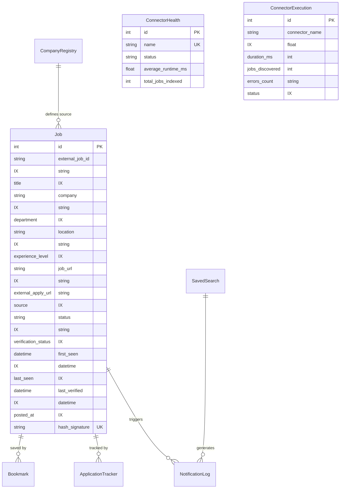

# JobPulse v2 — Database ER Diagram & Indexes

## ER Diagram

---

## Indexing Strategy (Step 18)

- `idx_jobs_company_exp_status`: Compound index on `(company, experience_level, status)` for fast search queries.
- `idx_jobs_verification_status`: Compound index on `(verification_status, status)` for background verification workers.
- Individual indexes on `external_job_id`, `company`, `location`, `experience_level`, `job_url`, `source`, `verification_status`, `posted_at`.
