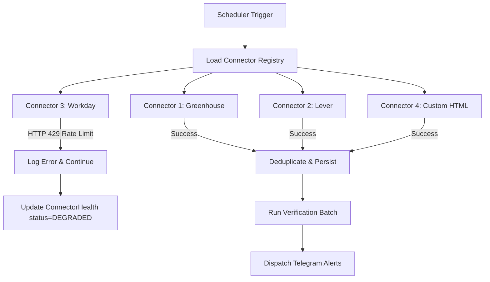

# JobPulse v2 — Scheduler & Failure Isolation

## Architectural Principles

1. **Independent Execution**: Every ATS connector runs in its own isolated async context.
2. **Failure Isolation**: One failing or rate-limited connector will never stop or block other connectors (`return_exceptions=True`).
3. **Execution Logging**: Detailed records logged in `connector_executions` table (`duration_ms`, `jobs_discovered`, `errors_count`).
4. **Health Diagnostics**: Dynamic health score calculated from execution history in `connector_health` table.

