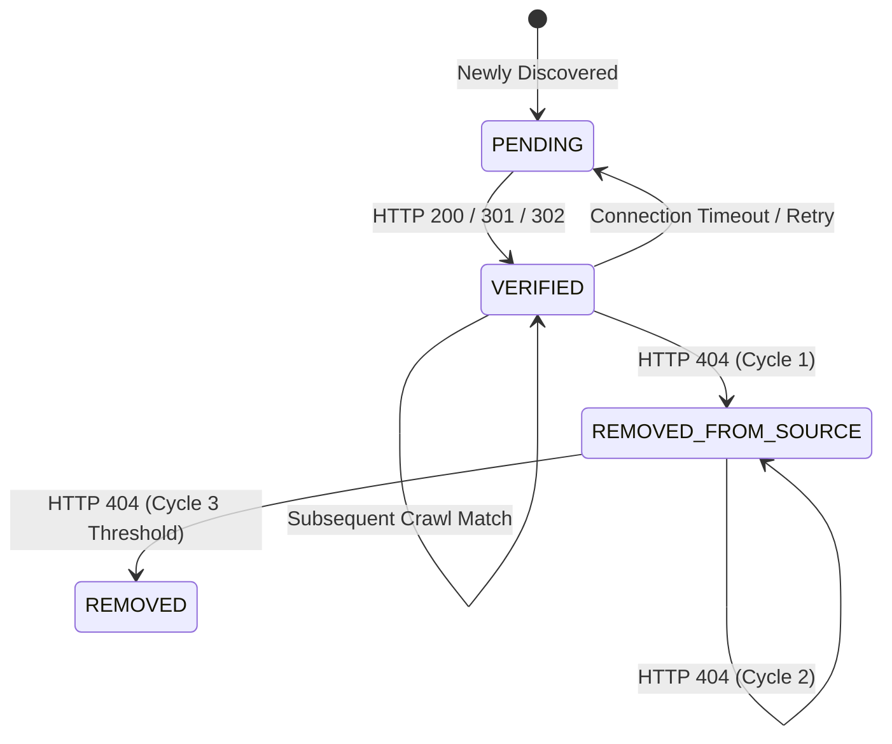

# JobPulse v2 — Verification Engine Flow

## Overview

The Verification Engine runs independently of job discovery to audit the availability of active listings and prevent 404 links on the user dashboard.

---

## State Definitions

- **ACTIVE**: Listing is verified live on source portal.
- **PENDING**: Temporary verification state due to network timeout or retry buffer.
- **VERIFIED**: Successfully returned HTTP 200 with expected title content.
- **REMOVED_FROM_SOURCE**: Target endpoint returned HTTP 404.
- **REMOVED**: Job surpassed `consecutive_missing_count >= 3` threshold and is hidden from main active feeds.
- **EXPIRED / FILLED**: Explicitly marked filled or closed by ATS response.
